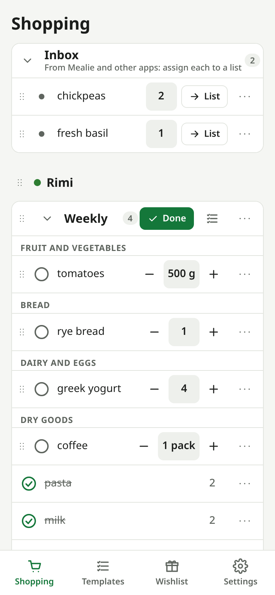
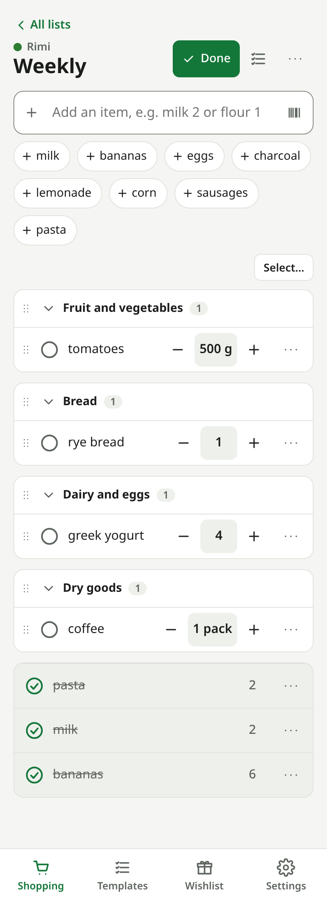
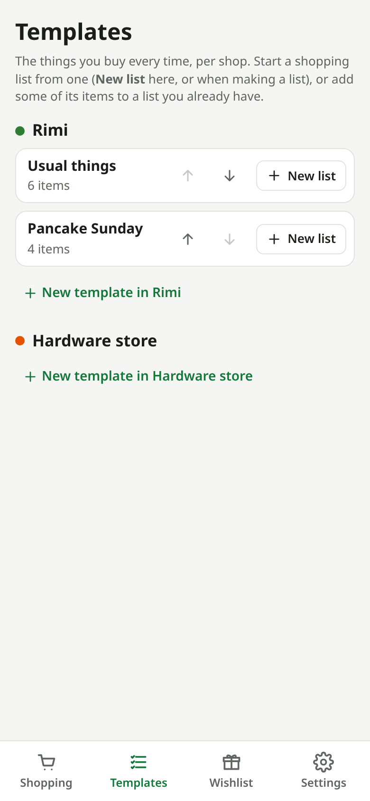
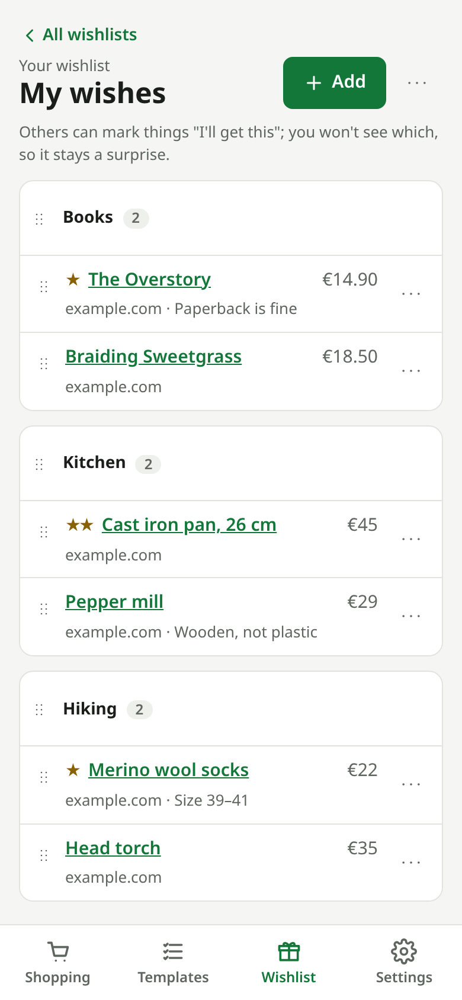
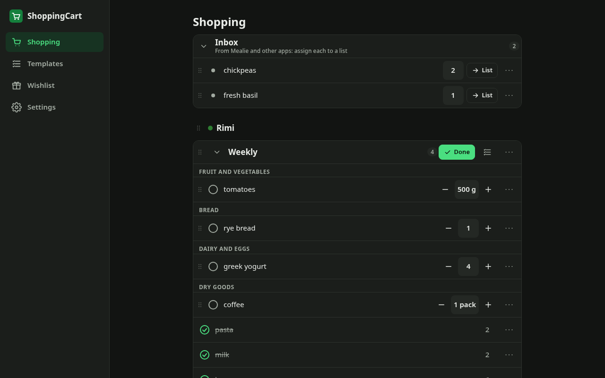

# ShoppingCart

[](https://github.com/Laurits7/ShoppingCart/actions/workflows/ci.yml)
[](https://laurits7.github.io/ShoppingCart/)
[](https://github.com/Laurits7/ShoppingCart/releases)
[](https://github.com/Laurits7/ShoppingCart/pkgs/container/shoppingcart)
[](LICENSE)

A lean, self-hosted shopping list and wishlist app for a household.

<table>
  <tr>
    <td></td>
    <td></td>
    <td></td>
    <td></td>
  </tr>
  <tr>
    <td align="center">Every list on one page</td>
    <td align="center">A list in the shop</td>
    <td align="center">Templates</td>
    <td align="center">Wishlists</td>
  </tr>
</table>



- **Shopping lists per shop**, split into categories (Dairy, Meat, Vegetables…), ordered by
  drag and drop, with templates per shop and an inbox.
- **Wishlists** with topic sections, and **gift lists** for other people that the recipient
  never sees, with "I'll get this" claims.
- **Private by default**: share a list with your household or invite individual people.
- **Live** across devices and people, usable on a flaky connection in the shop.
- **API** (OpenAPI, tokens) with integrations for [Mealie](https://mealie.io) and
  [Streamline](https://github.com/Laurits7/Streamline).
- **Small**: one Rust binary with an embedded web app and one SQLite file.

## Quick start

With the prebuilt image (amd64 and arm64, e.g. a Raspberry Pi): download
[`deploy/docker-compose.yml`](deploy/docker-compose.yml) (or the one attached to a
[release](https://github.com/Laurits7/ShoppingCart/releases)) into a folder, then:

```sh
mkdir data
docker compose up -d
```

Or build it yourself from this repository: `docker compose up -d --build`.

Open `http://<server-ip>:3100` and create the admin account. Your data is in `./data`.
What changed between versions is in the [changelog](CHANGELOG.md).

## Documentation

**Read them at <https://laurits7.github.io/ShoppingCart/>**: installing, HTTPS, backups, every
feature, the API and the integrations. They're built from [`docs/`](docs/index.md) (MkDocs) on
every push to `main`. To preview them locally:

```sh
python3 -m venv .venv && .venv/bin/pip install -r docs/requirements.txt
.venv/bin/mkdocs serve
```

## License

[GPL-3.0](LICENSE)
